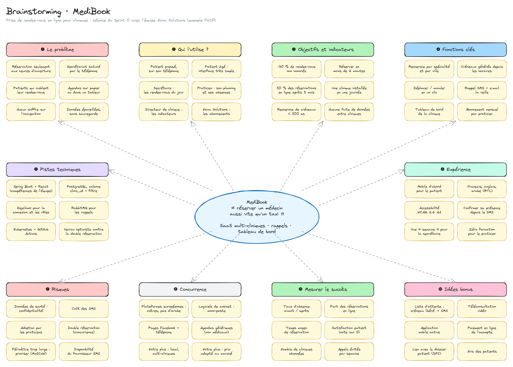
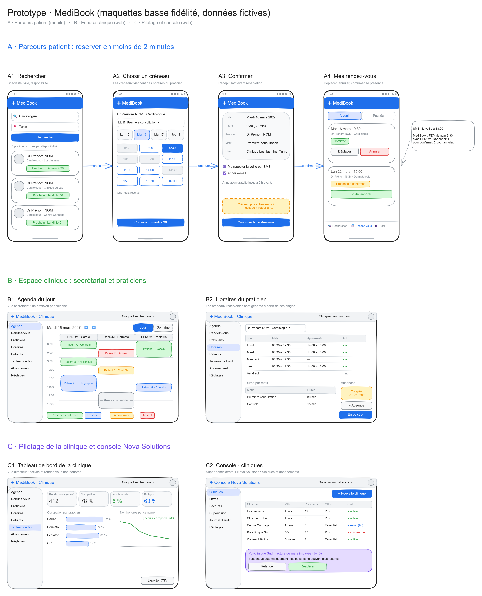
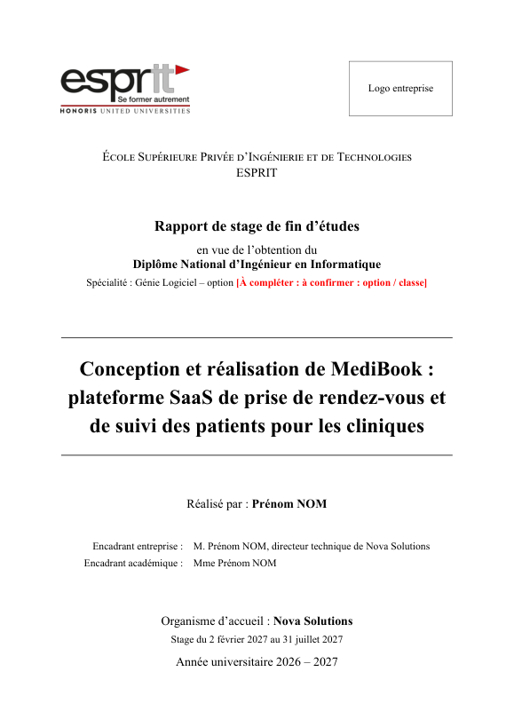
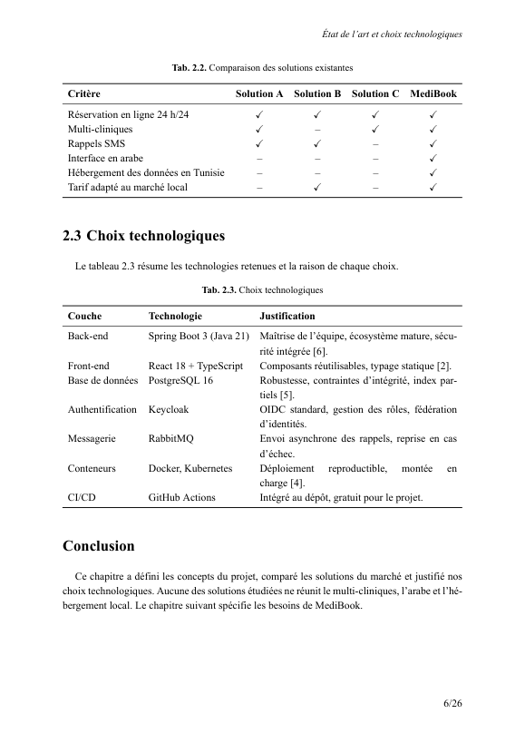
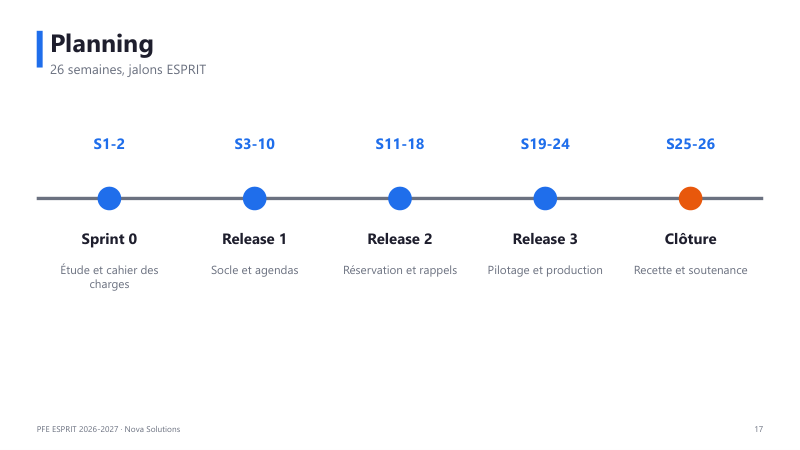

# Modèle de PFE ESPRIT : rapport LaTeX, cahier des charges, UML, présentation et Claude Code

Un dépôt prêt à l'emploi pour produire **tous les livrables écrits** d'un projet de fin d'études ESPRIT, de façon
cohérente et régénérable :

- 📘 **Rapport LaTeX** conforme à la note pédagogique ESPRIT (Times 12 pt, marges 2,5 cm, « Fig. »/« Tab. »,
  pagination x/N, Gantt, bibliographie, annexes, résumé/abstract)
- 📄 **Cahier des charges** écrit en Markdown → Word → PDF (table des matières, diagrammes insérés)
- 🧩 **Diagrammes UML** générés par script (draw.io) : cas d'utilisation, classes, séquence, activité, états, déploiement
- ✏️ **Figures Excalidraw** (architecture, CI/CD) au style croquis
- 💡 **Design Thinking en Excalidraw** : tableau de brainstorming (post-it) et prototype basse fidélité
  (maquettes mobile et web du parcours), éditables dans Obsidian Excalidraw
- 🎞️ **Présentation** PowerPoint 16:9 générée depuis un fichier de contenu
- 🤖 **Claude Code** : `CLAUDE.md`, règles, 8 skills (`/pfe-init`, `/pfe-rapport`, `/pfe-diagrammes`, `/pfe-design-thinking`,
  `/pfe-cahier`, `/pfe-presentation`, `/pfe-coherence`, `/pfe-journal`) et serveurs MCP

> Tout le contenu fourni est un **exemple fictif** : « MediBook », une plateforme de prise de rendez-vous pour
> cliniques, réalisée chez « Nova Solutions » par « Prénom NOM ». Remplacez-le par votre projet.

| Brainstorming | Prototype |
|---|---|
|  |  |

| Rapport | Page intérieure | Présentation |
|---|---|---|
|  |  |    |

## Démarrer

1. Cliquez sur **Use this template** (ou clonez le dépôt), puis passez votre copie en **privé** si elle contiendra
   des informations de votre entreprise.
2. Installez les outils :
   - LaTeX : [MiKTeX](https://miktex.org/) (Windows) ou TeX Live ; moteur XeLaTeX
   - [Python 3.10+](https://www.python.org/) puis `pip install -r requirements.txt`
   - [Node 18+](https://nodejs.org/) et Google Chrome, puis `npm install`
   - Facultatif : VS Code + les extensions recommandées (`.vscode/extensions.json`), Claude Code
3. Avec Claude Code, ouvrez le dossier et tapez **`/pfe-init`** : Claude vous pose les questions nécessaires et
   remplace l'exemple par votre projet. Sans Claude Code : modifiez `PROJET.md`, `rapport/config/infos.tex`,
   le front matter de `cahier/Cahier-des-charges.md` et `presentation/contenu.py`.

## Générer les livrables

| Livrable | Commande | Résultat |
|---|---|---|
| Tout | `sh scripts/build-all.sh` ou `powershell -ExecutionPolicy Bypass -File scripts/build-all.ps1` | tout ci-dessous |
| Diagrammes UML | `npm run diagrammes` | `diagrammes/*.drawio`, `diagrammes/png/`, `rapport/figures/uml/` |
| Figures Excalidraw | `npm run figures` | `rapport/figures/*.png`, `rapport/figures/excalidraw/` |
| Brainstorming et prototype | `npm run design` | `design-thinking/*.excalidraw.md`, `design-thinking/png/`, `rapport/figures/design-thinking/` |
| Rapport | `sh rapport/build.sh` ou `powershell -ExecutionPolicy Bypass -File rapport/build.ps1` | `rapport/main.pdf` |
| Cahier des charges | `python cahier/build_cahier_docx.py` | `cahier/Cahier-des-charges.docx` |
| Présentation | `python presentation/build_deck.py` | `presentation/Presentation.pptx` |
| PDF (Word/PowerPoint) | `powershell -ExecutionPolicy Bypass -File scripts/export-pdf.ps1 <fichier.docx/.pptx>` | `.pdf` à côté |
| PDF (LibreOffice) | `soffice --headless --convert-to pdf <fichier>` | `.pdf` |

Dans VS Code, l'extension LaTeX Workshop compile le rapport à chaque enregistrement (`Ctrl+Alt+V` pour l'aperçu).
GitHub Actions compile aussi le rapport, le cahier et la présentation à chaque push (onglet *Actions* →
artefacts).

## Organisation

```
PROJET.md                    ← faits du projet : SOURCE UNIQUE (noms, dates, stack, jalons, chiffres)
CLAUDE.md                    ← guide pour Claude Code
.claude/
  rules/                     ← règles chargées selon les fichiers modifiés (rédaction, LaTeX, diagrammes, slides)
  skills/                    ← /pfe-init, /pfe-rapport, /pfe-diagrammes, /pfe-cahier, /pfe-presentation, ...
  settings.json              ← commandes de génération autorisées sans confirmation
.mcp.json                    ← serveurs MCP : Context7 (documentation à jour), Playwright (captures d'écran)
rapport/
  main.tex                   ← point d'entrée
  config/infos.tex           ← VOS informations (une seule fois)
  config/preamble.tex        ← mise en page ESPRIT, \insererfigure, \todo, encadré definition
  pages/ chapitres/ annexes/ ← contenu
  figures/                   ← uml/ (généré), captures/, logos/, _source/ (Excalidraw)
cahier/                      ← Cahier-des-charges.md + build_cahier_docx.py
diagrammes/_source/          ← build_diagrams.py (UML), drawio.py (aides), render.js (PNG)
presentation/                ← contenu.py (texte des diapositives) + build_deck.py (mise en page)
design-thinking/             ← brainstorming.excalidraw.md, prototype.excalidraw.md, png/, _source/ (générateurs)
journal/                     ← journal de bord hebdomadaire
docs/guide-pfe-esprit.md     ← calendrier type et règles de mise en forme
scripts/                     ← build-all, export-pdf
```

## Astuces du rapport

- `\todo{...}` affiche un rappel rouge ; pour la version finale, `\afficherfalse` dans `config/preamble.tex`.
- `\insererfigure[0.8]{uml/03-sequence-prise-rdv.png}{Légende}{fig:label}` : une figure absente s'affiche comme
  un cadre rouge « Figure à produire », on peut donc rédiger avant d'avoir les images.
- `\insererfigurepaysage{...}` pour un grand diagramme sur une page en paysage.
- `\begin{definition}{Terme} ... \end{definition}` pour les encadrés de définition.
- Logos : `rapport/figures/logos/esprit.png` est fourni ; ajoutez `entreprise.png` (logo de votre organisme d'accueil).

## Claude Code

Ouvrez le dossier avec Claude Code : `CLAUDE.md` et les règles de `.claude/rules/` sont chargés automatiquement.
Exemples de demandes :

- `/pfe-init` : « mon sujet est ... chez ..., encadré par ... »
- `/pfe-rapport` : « rédige l'état de l'art en comparant Jira, Trello et Asana », « relis le chapitre 3 »
- `/pfe-diagrammes` : « ajoute un diagramme de séquence pour l'annulation d'un rendez-vous »
- `/pfe-design-thinking` : « voici les idées de notre brainstorming : ... », « dessine les maquettes du parcours d'inscription »
- `/pfe-presentation` : « prépare ma 1re restitution de 12 minutes »
- `/pfe-coherence` : « j'ai changé la date de fin, mets tout à jour »
- `/pfe-journal` : « voici ma semaine : ... »

Serveurs MCP (`.mcp.json`, Claude Code demande l'accord au premier lancement) :
**Context7** donne la documentation à jour des bibliothèques pour l'état de l'art et les choix techniques ;
**Playwright** pilote un navigateur pour faire des captures d'écran de votre application (chapitre 5).

## Avertissement

Ce modèle n'est pas un document officiel d'ESPRIT. Vérifiez toujours les consignes de votre année (note
pédagogique, page de garde officielle, calendrier) et adaptez le modèle en conséquence.

## Licence

[MIT](LICENSE) : utilisez, modifiez et partagez librement.
